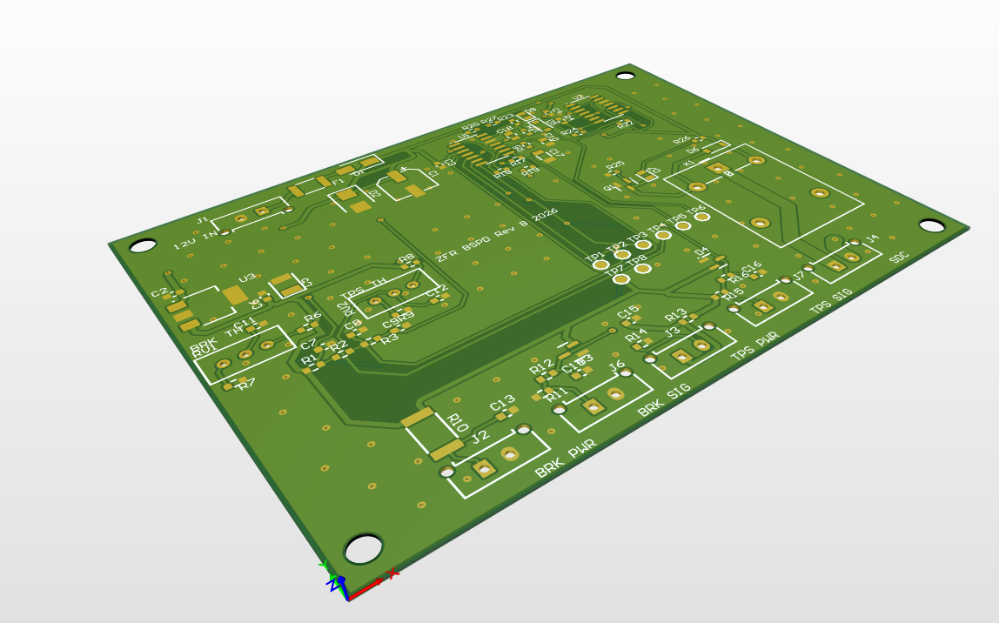
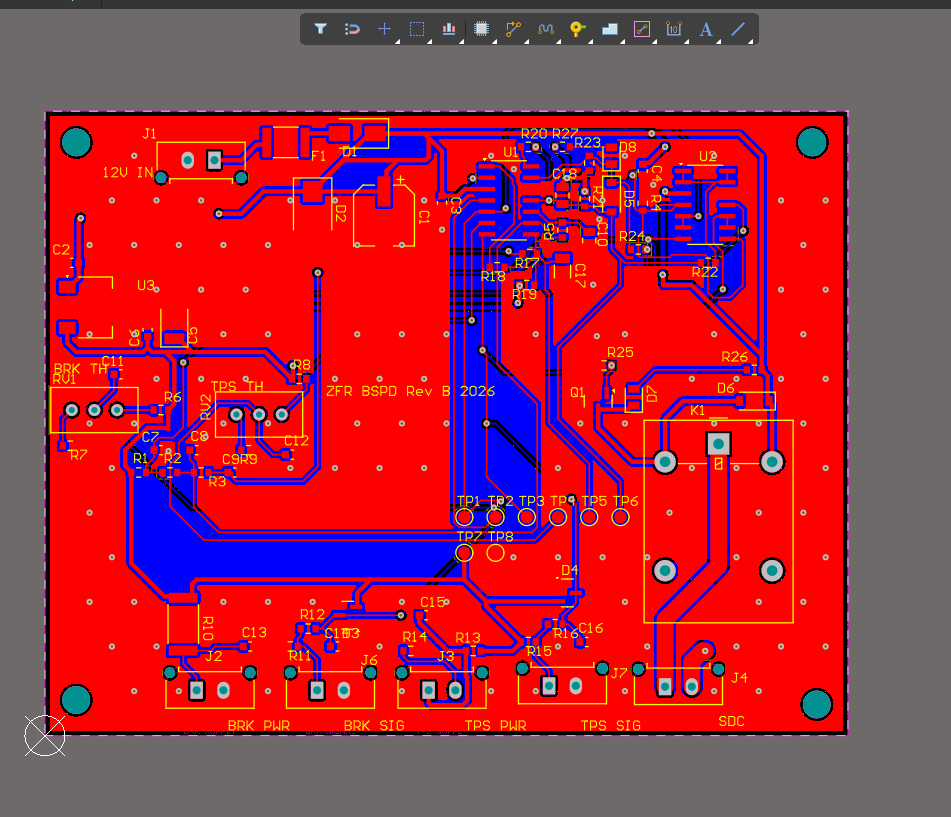
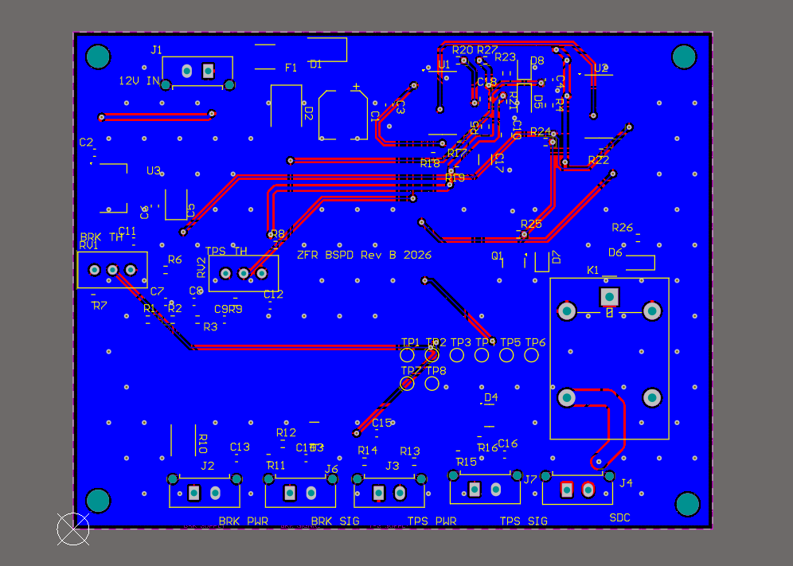
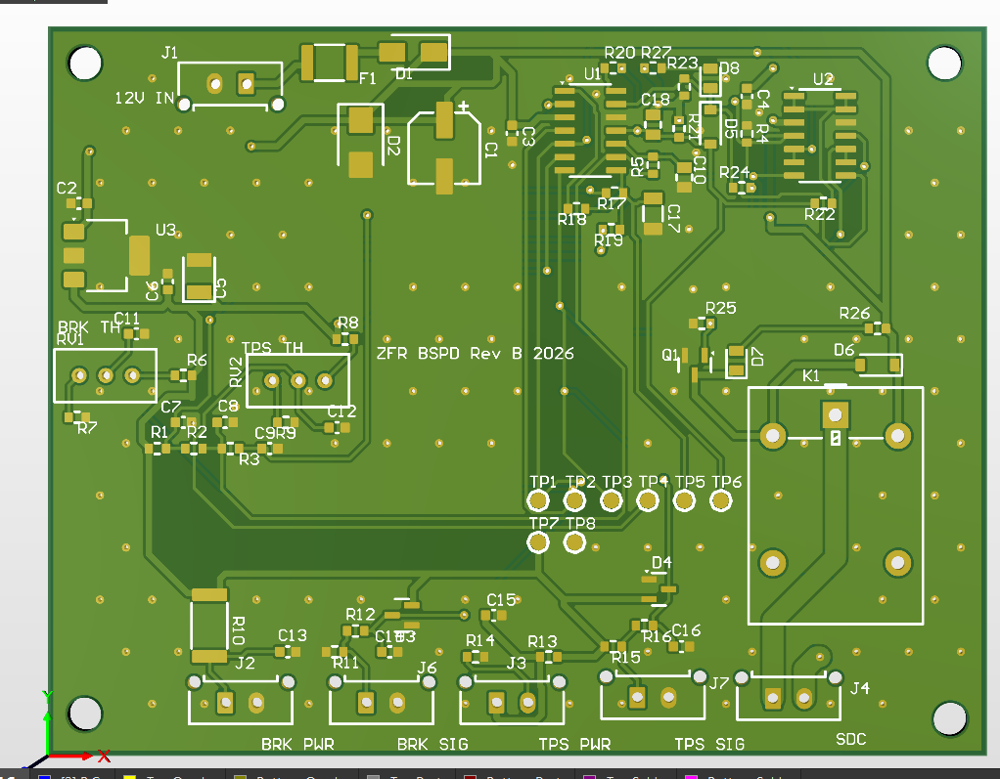
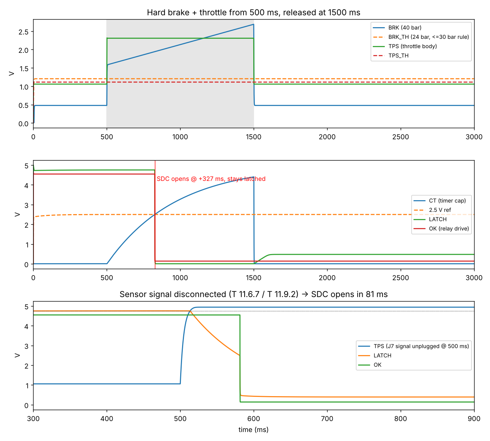

# ZFR BSPD – Brake System Plausibility Device

This is the BSPD I designed for **Zuura Formula Racing (ZFR)**, our Formula Student combustion car running a **Kawasaki ER-6n 650** on the stock ECU.

The job of a BSPD is simple. If the driver is braking hard and the throttle is open at the same time for too long, it cuts the shutdown circuit and kills the engine. It does the same if any of its sensor wires breaks or shorts. Once it trips, it stays tripped until the low-voltage master switch is turned off and on again.

I kept the whole thing analog: comparators, an RC timer and a relay, with no microcontroller anywhere. The FS rules require it to be a standalone non-programmable circuit, and a comparator design is also much easier to explain and get through tech inspection.



---

## What it does
- Trips when **hard braking + more than 25 % throttle** last longer than **~327 ms**. The rule limit is 500 ms, and across component tolerances my worst case came out at 256–350 ms.
- Detects **open, short-to-GND and short-to-5 V** on both sensor wires, and trips in about **70–80 ms**. Short glitches (under ~50 ms) are filtered out, so a bit of wiring noise won't kill the car.
- **Latches** until the LVMS is power-cycled.
- **Fail-safe**: the SDC relay is only closed while the board is powered and healthy. Pull the 12 V or lose the 5 V and the SDC opens.
- The **brake threshold can't be set above 30 bar**. The trimmer range itself is limited (5.6–26.4 bar, 28.4 bar worst case), so it can't be tuned out of the rule by mistake.
- Uses its **own brake and throttle sensors**, so I never had to touch the Kawasaki ECU wiring.

## Rules I designed against (FS Rules 2025 v1.0)
| Rule | What it asks | How I handled it |
|---|---|---|
| T 11.6.1 | Standalone, non-programmable; open the SDC on hard braking + throttle > 25 % over idle; stay latched | LM2901 comparators + diode latch; trips at 20 % throttle for margin |
| T 11.6.2 | Act if the implausibility lasts > 500 ms | RC timer, ~326 ms |
| T 11.6.3 | Powered directly from the LVMS | J1 input, only a fuse in between |
| T 11.6.4 | Only power, sensor and SDC interfaces | J1, J2/J6, J3/J7, J4 + bare test pads (no header) |
| T 11.6.5 | Brake pressure sensor, threshold ≤ 30 bar, no wheel lock | MLH02K sensor, trimmer range capped at ≤ 28.4 bar |
| T 11.6.7 | Each sensor signal wire separately disconnectable | Signal-only connectors J6 (brake) and J7 (throttle) |
| T 11.9.2 | Open / short-GND / short-supply must go to the safe state | Window comparators at 0.25 V and 4.75 V |
| CV 1.4.3 | Throttle position measured at the throttle body | 3382H sensor on the throttle shaft |
| CV 4.1.1 / 4.1.3 | SDC drives relays; de-energised = open | Normally-open relay contact (K1) in series with the SDC |

## How the circuit works
```
Brake sensor ─► filter/clamp ─► U1A  brake > threshold ──┐
                         └────► U2A/B window (0.25–4.75 V) ─────┐
Throttle sensor ─► filter/clamp ─► U1B  throttle > 20 % ─┤      │ wire fault (~70 ms)
                         └────► U2C/D window ───────────────────┤
                                                       ▼        ▼
                         both true ─► RC timer (326 ms) ─► U1D ─► U1C latch ─► Q1 ─► K1 (SDC)
```
- **Power:** 12 V in → polyfuse → reverse-polarity diode → TVS → LM2940 5 V LDO. Every reference and both sensors run off the same 5 V, so the thresholds stay ratiometric.
- **Thresholds:** two 25-turn trimmers (RV1 for brake, RV2 for throttle), plus a fixed divider for the fault limits and the 2.5 V timer/latch reference.
- **Timer:** C17 only charges while *both* conditions are true. If either drops, it's discharged straight away.
- **Latch:** once U1C trips, D5 holds it there. Nothing but a power cycle resets it.
- **Output:** AO3400A MOSFET → Omron G5LE relay. Green LED = OK, red LED = tripped.

## PCB
- 2 layers, **90 × 70 mm**, 1.6 mm FR-4, 1 oz copper
- Laid out and routed in **Altium Designer**
- GND pour on both layers + stitching vias
- Power traces 0.6 mm, SDC traces 2 mm, signals 0.3 mm, 0.25 mm clearance
- 4 × M3 mounting holes, 8 test pads for setting thresholds and the tech-inspection demo
- **DRC: 0 violations**

| Top | Bottom |
|---|---|
|  |  |



## Simulation
Before laying out the board, I ran the circuit through a behavioural ngspice test bench (`simulation/bspd_sim.py`) with **24 test cases, all passing**:
- normal operation, brake only, throttle only, and a 200 ms overlap (no trip)
- the real trip (327 ms) and making sure it stays latched afterwards
- all 9 sensor-wire faults (68–81 ms)
- supply dips down to 6 V, and 9 V / 16 V supply
- 40 random power-ups to check it never false-trips at start-up
- Monte-Carlo on the timer (256–350 ms)



## Repo layout
| Folder | What's in it |
|---|---|
| `hardware/altium/` | Altium schematic + PCB |
| `hardware/kicad/` | Original KiCad schematic and libraries (the starting point before Altium) |
| `hardware/BOM.csv` | Full BOM with alternate part numbers for every part |
| `fabrication/` | `bspd_rev_gerberfiles.zip`: Gerbers + plated / non-plated drill files, ready to upload to JLCPCB / PCBPower |
| `docs/` | Schematic PDF and board images |
| `simulation/` | ngspice test bench and results |
| `tools/` | Python scripts I used to generate and cross-check the netlist |

## Main parts
| Function | Part | Alternates |
|---|---|---|
| Comparators | TI LM2901DR | onsemi LM2901DR2G, TI LM339ADR |
| 5 V LDO | TI LM2940IMP-5.0 | TI LM2937IMP-5.0 |
| SDC relay | Omron G5LE-1 DC12 | G5LE-14 DC12, G5LE-1-E DC12 |
| Relay driver | AO3400A | Si2302CDS, IRLML6344 |
| Brake pressure sensor | Honeywell MLH02KPSB06A (0–2000 psi, 0.5–4.5 V) | MLH01KPSB06A |
| Throttle position sensor | Bourns 3382H-1-103 | Bosch 0 280 122 001, Piher PST360 |

The full list with every resistor and cap is in `hardware/BOM.csv`.

## Setting it up on the car
1. **Brake threshold (RV1, measure at TP2):** `V = 0.5 V + 0.029 V/bar × P`. Set it below the pressure where the wheels start locking, and never above 30 bar.
2. **Throttle threshold (RV2, measure at TP4):** `V = V_idle + 0.20 × (V_WOT − V_closed)`, using readings from TP3.
3. Lock both trimmers with a dab of paint once they're set.
4. Check it: hard brake + throttle → the SDC should open within 0.26–0.40 s and stay open until the LVMS is cycled.
5. Unplug J6, then J7 → it should trip both times (this is what scrutineers check for T 11.6.7).

## Status
- [x] Schematic + simulation
- [x] PCB layout and routing, DRC clean
- [x] Gerbers generated
- [ ] Fabrication
- [ ] Bench testing
- [ ] On-car integration and tech inspection

## About
Designed by **Abhinav Pramod**, Electrical Department, Zuura Formula Racing, VIT Chennai.
GitHub: [@abhinavpramod23](https://github.com/abhinavpramod23)
